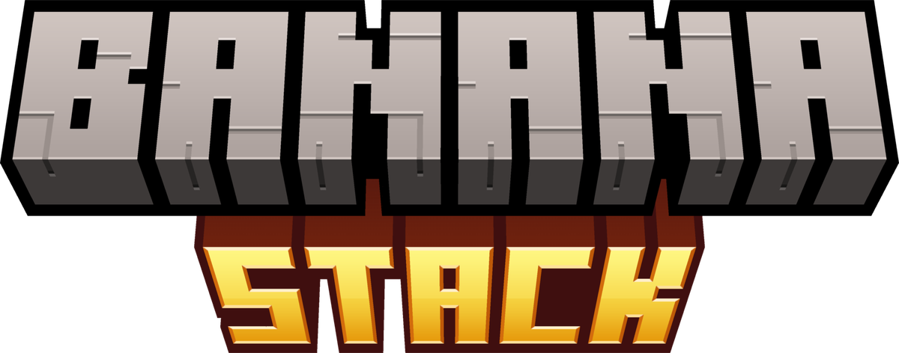
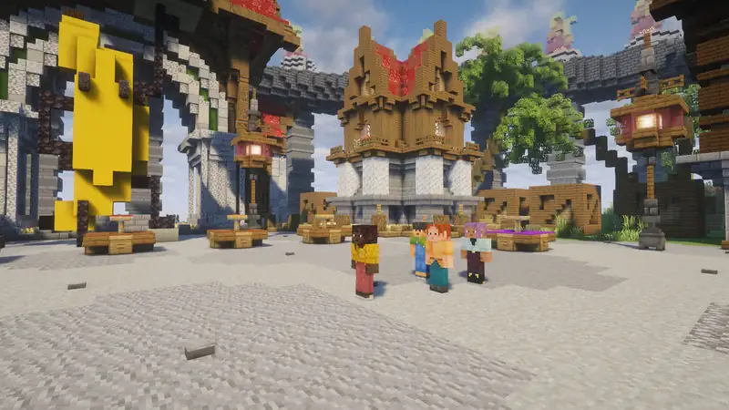
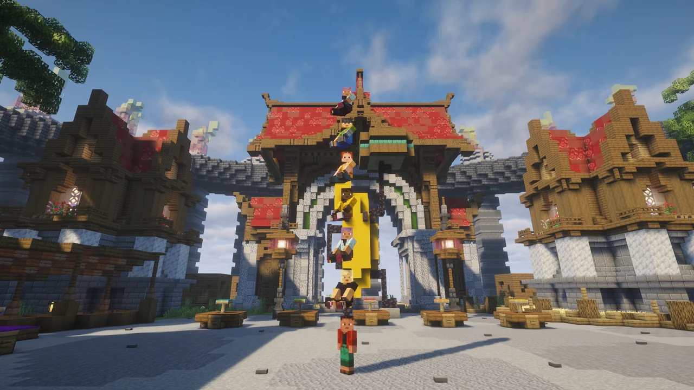

<div align="center">



Hop on your friends' heads and stack up into towers. Server-side, so players don't need to install anything.

[Modrinth](https://modrinth.com/mod/banana-stack) · [Report a bug](https://github.com/bossgaming8/banana-stack/issues) · [Discord](https://discord.gg/bananasandwich) · [bananasandwich.us](https://www.bananasandwich.us)



</div>

## How it works

- **Ride someone.** Walk up behind a player and right-click them with an empty hand. You sit on their head and go wherever they go.
- **Stack up.** Right-click the player at the bottom of a stack and you climb straight to the top. There's no limit unless the server sets one.
- **Hop off.** Press <kbd>Shift</kbd>. Riders land on the ground next to the stack, never in a long fall from the top.
- **Shake everyone off.** If you're at the bottom, <kbd>Shift</kbd> drops the whole stack. Holding it also stops anyone from climbing on.
- **Leaving the middle.** If someone in the middle hops off, everyone above them slides down, so the tower stays together.
- **Your hands stay free.** Riders sit just above your eyes, so you can still mine, build and fight while carrying people.

The first time someone hops on you, you're told how to shake them off, and `/stack off` stops people riding you at all.



## The fiddly parts, handled

- Low ceilings: riders duck down to sit right on the head, and bump off if there's no room at all.
- Teleports, portals, ender pearls, logging out, dying, going into spectator or sleeping all take you out of the stack cleanly. Riders are never carried off to someone else's home.
- A rider logging out never takes the player below them out of the world with them, which is what vanilla would do.
- If the server stops unexpectedly, riders are saved on the ground next to the stack, not in mid-air.
- Vanished players (with [Vanish](https://modrinth.com/mod/vanish)) can't ride or be ridden, so nothing gives them away.

## Commands

| Command | What it does |
|---|---|
| `/stack` | How it works, and whether others can ride you |
| `/stack off` / `/stack on` / `/stack toggle` | Stop (or allow) other players riding you. Saved with your player. |
| `/stack reload` | Reloads `config/bananastack.json` (operators) |

`/bananastack` works too, in case another mod already uses `/stack`.

## Permissions

With LuckPerms or another permissions mod, these nodes are checked. Everything is allowed by default except reloading.

| Node | Default | |
|---|---|---|
| `bananastack.ride` | everyone | Hop on other players |
| `bananastack.carry` | everyone | Be ridden |
| `bananastack.command` | everyone | Use `/stack` |
| `bananastack.command.reload` | operators | Use `/stack reload` |

## Config

`config/bananastack.json`:

| Option | Default | |
|---|---|---|
| `enabled` | `true` | Turns riding on or off for the whole server |
| `requireEmptyHand` | `true` | Riders need an empty main hand, so right-clicking someone with a sword or food never picks them up |
| `behindAngle` | `60` | How closely a rider has to face the same way as the player they hop on, in degrees. `180` allows any side. |
| `maxStackSize` | `0` | Most players in one stack, counting the bottom one. `0` means no limit. |
| `messages` | `true` | The hints above the hotbar |
| `sounds` | `true` | The pop when someone hops on or gets shaken off |
| `particles` | `true` | The puff when riders get shaken off |

## Requirements

- Minecraft 26.3 with Fabric Loader 0.19.5 or newer
- [Fabric API](https://modrinth.com/mod/fabric-api)

Install it on the server. Players connect with a normal vanilla client. It also works in singleplayer and LAN worlds if you install it in your own game.

## Building

You need JDK 25.

```sh
./gradlew build
```

The jar is written to `build/libs`. `./gradlew runGameTest` runs the server tests and `./gradlew runClientGameTest` drives a real client through riding, stacking and shaking off.

## License

Copyright © 2026 Bhored. All rights reserved. See [LICENSE](LICENSE).
