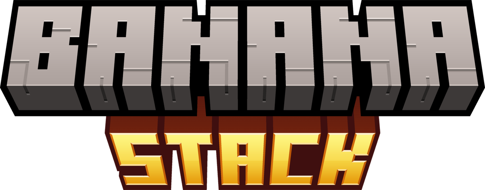
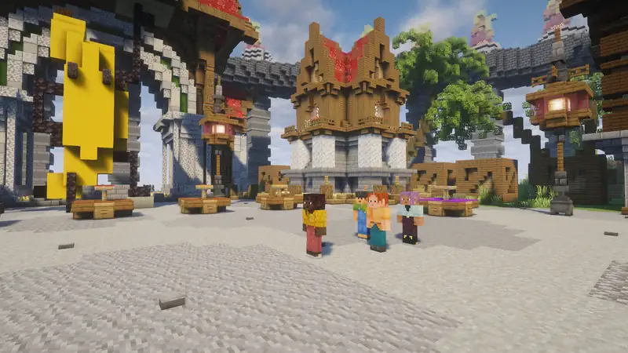
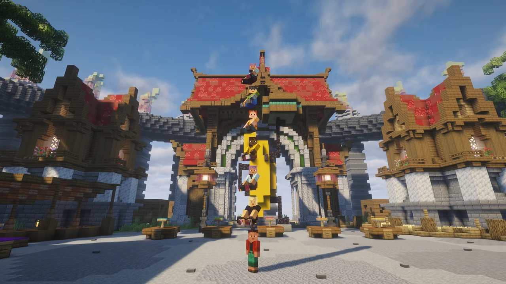
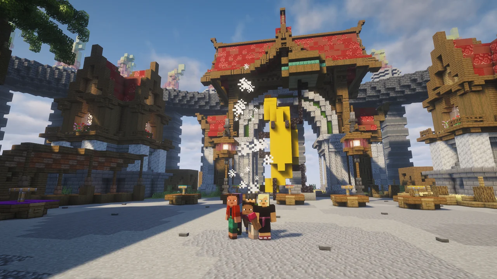
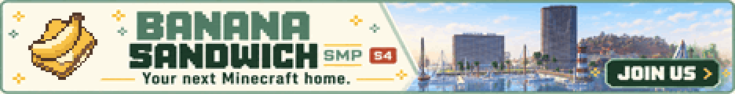

&nbsp;&nbsp;
&nbsp;&nbsp;
&nbsp;&nbsp;

**Hop on your friends' heads and stack up into towers. Server-side: players join with a normal vanilla client.**

## Features

### Ride anyone
Walk up behind a player and **right-click** them with an empty hand. You sit on their head and go wherever they go.

### Stack up
Right-click the player at the **bottom** of a stack and you climb straight to the top. Towers can be as tall as your server allows.

### Hop off, or shake everyone off
- Press **Shift** to hop off. You land on the ground next to the stack, never in a long fall from the top.
- At the bottom, **Shift** shakes the whole stack off. Holding it also stops anyone from climbing on.
- If someone in the middle hops off, everyone above them slides down, so the tower stays together.

### Your hands stay free
Riders sit just above the eyes of the player below, so the carrier can still mine, build and fight. Under low ceilings riders duck down onto the head, and they bump off when there's no room at all.

### Nobody gets carried off
Teleports, portals, ender pearls, logging out, dying, spectator mode and sleeping all take you out of the stack cleanly. Riders are never dragged along to someone else's home, and a rider logging out never takes the player below them out of the world.

### Riding is opt-out
The first time someone hops on you, you're told how to shake them off. Type `/stack off` and nobody can ride you until you turn it back on.

## Controls

| Action | How |
|---|---|
| Ride someone | Right-click them from behind with an empty hand |
| Climb a stack | Right-click the player at the bottom |
| Hop off | `Shift` |
| Shake everyone off | `Shift`, at the bottom |
| Stop people riding you | `/stack off` (`/stack on` to allow it again) |

## For server owners

- Install it on the **server** only; players connect with a normal vanilla client. It also works in singleplayer and LAN worlds.
- `config/bananastack.json` turns riding on or off, requires an empty hand, sets how far behind riders have to be (`behindAngle`, where 180 means any side) and the largest stack, and switches the hints, sounds and particles.
- Permission nodes for LuckPerms and other permission mods: `bananastack.ride`, `bananastack.carry`, `bananastack.command` and `bananastack.command.reload`. Everything is allowed by default except reloading.
- Vanished players ([Vanish](https://modrinth.com/mod/vanish)) can't ride or be ridden, so nothing gives them away.
- `/stack reload` reloads the config. `/bananastack` works too if another mod already uses `/stack`.

## Requirements

- Minecraft **26.3** with Fabric Loader 0.19.5+
- [Fabric API](https://modrinth.com/mod/fabric-api)

---

## Play on Banana Sandwich SMP

Banana Stack is made by Bhored for **Banana Sandwich SMP**, a mature (18+), Hermitcraft-inspired vanilla server with proximity voice chat, built around genuine collaboration and fun.

**[Visit bananasandwich.us](https://www.bananasandwich.us)** or **[apply on our Discord](https://discord.gg/bananasandwich)** to join.

---

Found a bug or have an idea? [Open an issue on GitHub](https://github.com/bossgaming8/banana-stack/issues). If you'd like to support development, you can [donate through PayPal](https://www.paypal.com/paypalme/BhoredM).
